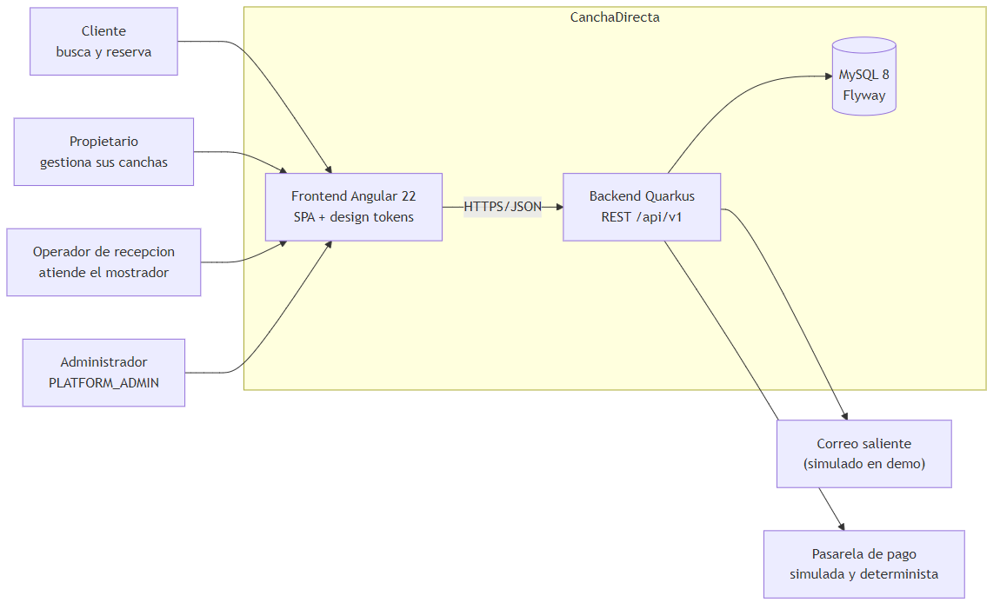
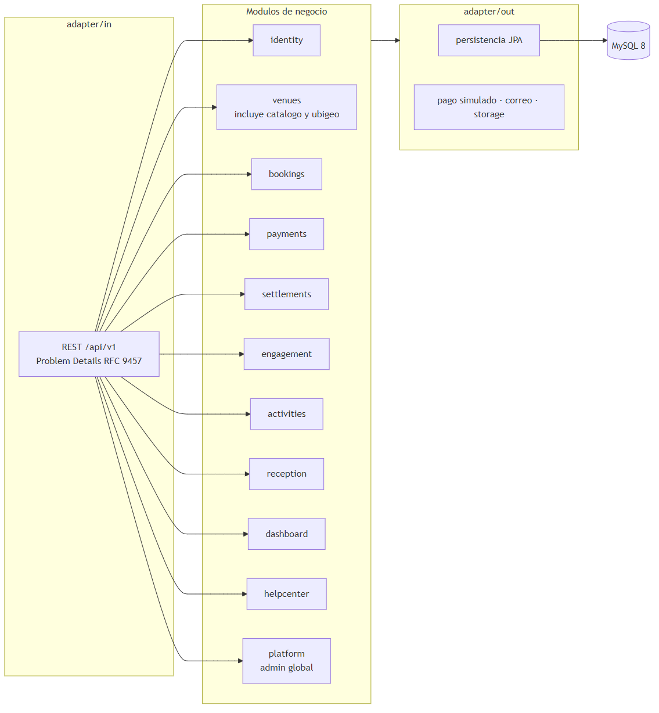
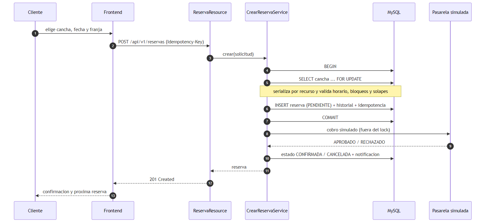
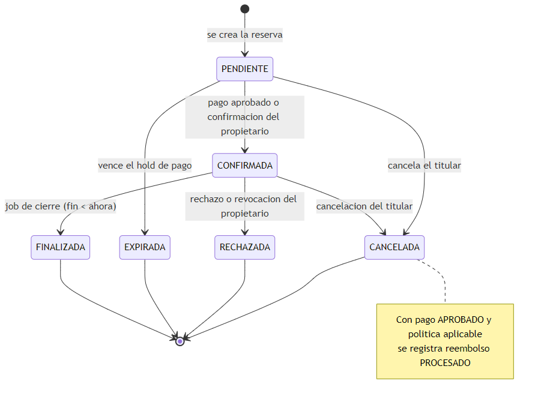
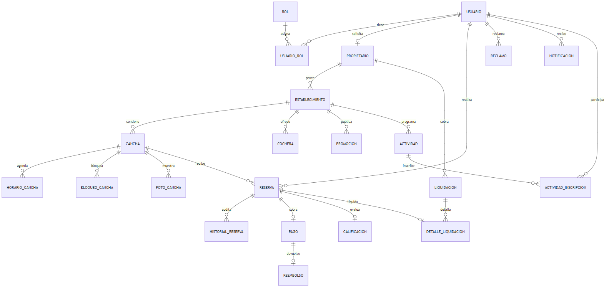
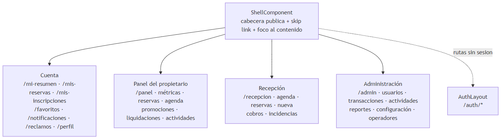
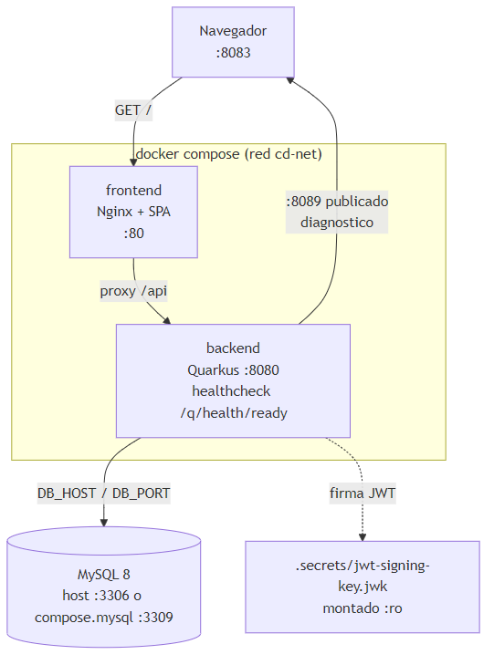

# Arquitectura

## 1. Estilo

Monolito modular + arquitectura hexagonal (Clean Architecture). Un backend, una base
MySQL, un frontend Angular. Sin microservicios, mensajeria, Redis ni Kubernetes por
defecto (ADR-0001).

**Sin microservicios** significa que hay **un solo backend Quarkus, un solo proceso y un solo
despliegue**: los modulos de la seccion 2 son paquetes internos del mismo artefacto, comparten la
misma base de datos y se llaman en memoria a traves de sus puertos. Un microservicio seria un
proceso desplegable por separado, con su propia base de datos o contrato de red y comunicacion
entre servicios (HTTP, colas, etc.). Ese modelo se descarto a proposito (ADR-0001); la separacion
por modulos y capas permite extraer uno en el futuro sin reescribir el dominio.



## 2. Modulos (capacidades de negocio)

| Modulo | Responsabilidad |
|---|---|
| `identity` | usuarios, roles, credenciales, verificacion de correo, recuperacion, propietarios |
| `venues` | establecimientos, canchas, horarios, precios, bloqueos, cocheras (RN-08), catalogo publico, busqueda, comparacion, fotos y ubigeo (absorbe `catalog` y `geography`) |
| `bookings` | disponibilidad, reservas, historial, expiracion, cierre, cancelacion, cambios |
| `payments` | pago simulado, reembolso, idempotencia, politicas |
| `settlements` | comisiones, ingresos, liquidaciones |
| `engagement` | calificaciones, reclamos, notificaciones |
| `activities` | actividades deportivas, cupos e inscripciones |
| `reception` | operadores de recepcion, agenda del dia, walk-in y cobros en mostrador |
| `dashboard` | metricas del propietario (ocupacion, ingresos, demandas) |
| `helpcenter` | centro de ayuda: categorias, articulos y busqueda |
| `platform` | operaciones globales: usuarios/roles, propietarios, supervision, auditoria, configuracion, reportes, promociones y cocheras |
| `shared` | RFC 9457, seguridad JWT/JWKS, reloj, storage y utilidades transversales |



## 3. Capas por modulo

```text
<module>/
  domain/                    # agregados, value objects, reglas - SOLO Java
  application/
    port/in/                 # casos de uso (interfaces)
    port/out/                # repositorios, reloj, tokens, email, storage, pago
    service/                 # orquestacion
    dto/                     # DTO de aplicacion (no REST)
  adapter/in/rest/           # controllers, request/response, validacion de borde
  adapter/out/persistence/   # entidades JPA, repositorios, mappers
  adapter/out/<otros>/       # security, payment, email, storage
```

**Reglas inviolables:** `domain` sin `@Entity/@Path/@ApplicationScoped/@Transactional`
ni dependencias a Quarkus/HTTP/MySQL; puertos hacia dentro, adaptadores los
implementan; controllers sin SQL/reglas/precio/estados; entidades JPA ? DTO REST ?
dominio; `BigDecimal` para montos.

## 4. Flujo critico: reserva concurrente (ADR-0005)

```text
POST /api/v1/bookings  [Idempotency-Key]
  -> validar sesion, ventana, duracion
  -> BEGIN (InnoDB)
  -> SELECT ... FROM cancha WHERE id=? FOR UPDATE        -- serializa por recurso
  -> validar establecimiento/cancha activos, horario aplicable, bloqueos
  -> interseccion: nuevoInicio < existenteFin AND nuevoFin > existenteInicio
  -> (opcional) SELECT cochera FOR UPDATE (orden consistente cancha->cochera, ADR-0019)
  -> (opcional) cupo = capacidad - reserva_cochera vigente que se solapa
  -> calcular tarifa + descuento; snapshot de importe
  -> INSERT reserva (PENDIENTE) + historial_reserva + idempotencia
  -> COMMIT
  -> (fuera del lock) resultado de pago simulado en nueva transaccion idempotente
  -> transicion CONFIRMADA / CANCELADA + notificacion
```



### 4.1 Flujo del pago simulado y reembolso (ADR-0020)

```text
POST /api/v1/reservas/{id}/pago           [titular]
  -> reserva PENDIENTE/CONFIRMADA y sin pago APROBADO (si no, 409, RN-05)
  -> monto = monto_cancha - monto_descuento + monto_cochera
  -> pago_evento(SOLICITADO) -> PaymentGatewayPort (simulador determinista)
  -> INSERT pago (APROBADO|RECHAZADO) + pago_evento(resultado)   -- COMMIT
GET  /api/v1/reservas/{id}/pago  -> ultimo pago + reembolsos

cancelar (titular) / rechazar (propietario)
  -> cambiarestado + PoliticaReembolso (misma transaccion)
  -> si hay pago APROBADO y procede: INSERT reembolso(PROCESADO)
     + pago.estado = REEMBOLSADO + pago_evento(REEMBOLSADO)
```

### 4.2 Flujo de la liquidacion del propietario (ADR-0021)

```text
POST /api/v1/liquidaciones                       [propietario]
  -> BEGIN; SELECT id_propietario FROM propietario ... FOR UPDATE   -- serializa (RN-07)
  -> reservas liquidables (read model reserva+pago): pago APROBADO y reserva
     CONFIRMADA/FINALIZADA, DATE(inicio) en [periodo] y aun sin liquidar
  -> por reserva: comision = round(monto x cd.liquidaciones.porcentaje-comision/100, 2)
                  neto     = monto - comision
  -> INSERT liquidacion (PENDIENTE) + detalle_liquidacion (UNIQUE id_reserva)
  -> COMMIT
GET  /api/v1/liquidaciones                        -> cabeceras del propietario
GET  /api/v1/liquidaciones/{id}                   -> cabecera + lineas de detalle
```

### 4.3 Flujo de la expiracion del hold y la revocacion (ADR-0022)

```text
Job @Scheduled(60s)  -> ExpirarReservasUseCase.expirarVencidas(lote)   [transaccional]
  -> reservas PENDIENTE sin pago APROBADO con fecha_creacion < NOW() - hold
     (hold = config_establecimiento.hold_pago_min, o cd.reservas.hold-pago-min)
  -> SELECT ... FOR UPDATE OF r (solo la reserva; no bloquea la cancha)
  -> UPDATE reserva SET estado = EXPIRADA + historial_reserva   -- libera la franja

POST /api/v1/reservas/{id}/revocar                [propietario]
  -> reserva CONFIRMADA y no comenzada (si no, 409)
  -> estado = RECHAZADA + historial_reserva
  -> PoliticaReembolso(porPropietario = true): reembolso total si habia pago APROBADO

Job @Scheduled(60s)  -> FinalizarReservasUseCase.finalizarConcluidas(lote)   [transaccional]
  -> reservas CONFIRMADA con fin < UTC_TIMESTAMP(6)   -- inicio/fin son literales UTC (ADR-0014)
  -> SELECT ... FOR UPDATE (solo la reserva; no bloquea la cancha)
  -> UPDATE reserva SET estado = FINALIZADA + historial_reserva   -- cierra el ciclo, sin reembolso
```

**Nota de relojes (L-04):** la expiracion mide `fecha_creacion` contra `NOW(6)` (hora local del
servidor, la misma que la llena por defecto) y la finalizacion mide `fin` contra `UTC_TIMESTAMP(6)`
(la columna es un literal UTC). Cada job compara contra el mismo marco horario que su columna; ninguno
depende de la zona del servidor.

### 4.4 Estados de la reserva



## 5. Contrato REST

Bajo `/api/v1`. Errores RFC 9457 (Problem Details) con `code` de negocio
(`SLOT_UNAVAILABLE`, `OWNER_RESOURCE_FORBIDDEN`, `PAYMENT_DECLINED`, ...). Ver
`API.md` (pendiente) y Swagger en `/q/swagger-ui`.

## 6. Persistencia

MySQL 8 (host), InnoDB, utf8mb4. **Flyway es dueno del esquema**; Hibernate solo
valida. Migraciones `V1..V18` (ver `MODELO_DATOS.md`). Usuario de migracion y de
runtime separados (ADR-0009).



## 7. Frontend

Angular 22 standalone, lazy por areas (`public/auth/account/booking/owner/reception/admin`),
TS strict, Signals + RxJS, reactive forms, interceptors (auth/errores/carga), guards como
apoyo de UX (nunca unica seguridad), CSS con design tokens y tema claro/oscuro, mobile-first,
WCAG 2.2 AA, estados loading/empty/error/success en todas las areas. Los portales se resumen en
`DIAGRAMAS.md`.



## 8. Infraestructura

Dockerfiles multi-stage no-root, Nginx con fallback SPA y proxy `/api`, Compose con variante
host (`host.docker.internal`) y variante MySQL aislado (`compose.mysql.yml`, :3309), healthchecks,
JWKS montado de solo lectura, `.env.example` y `.dockerignore`. Puertos por defecto: frontend
:8083, backend :8089 (contenedor :8080), MySQL del host :3306.


