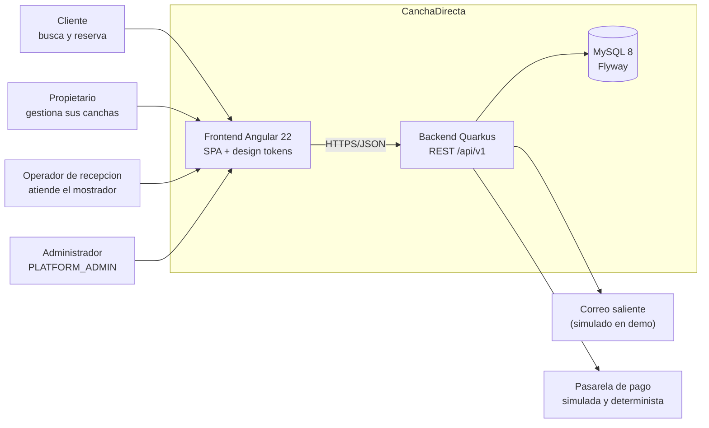
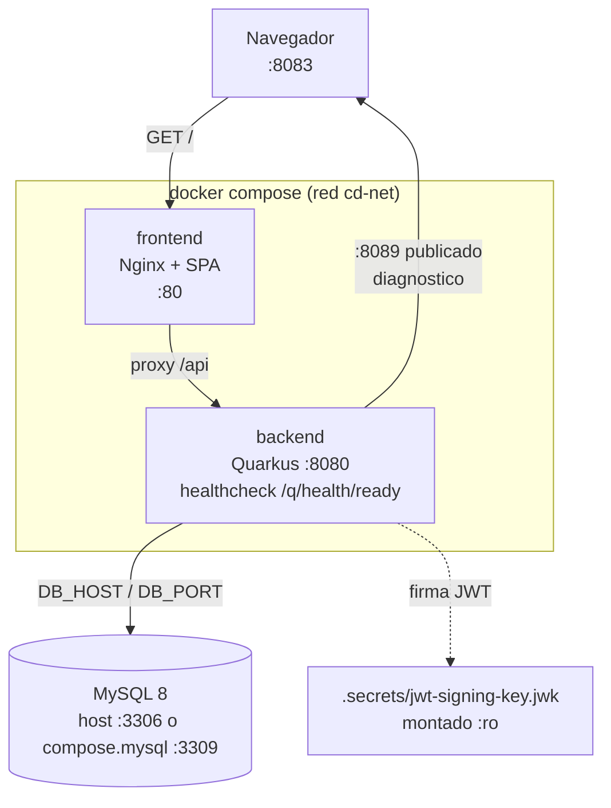
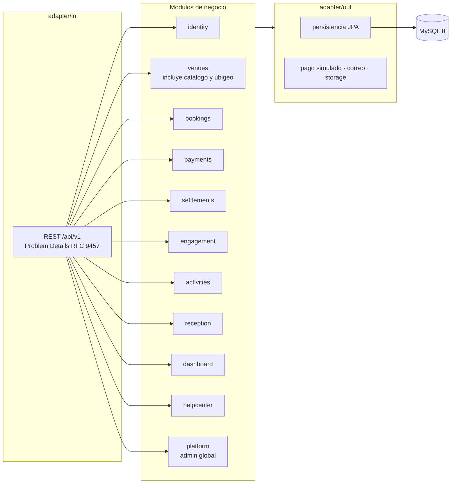
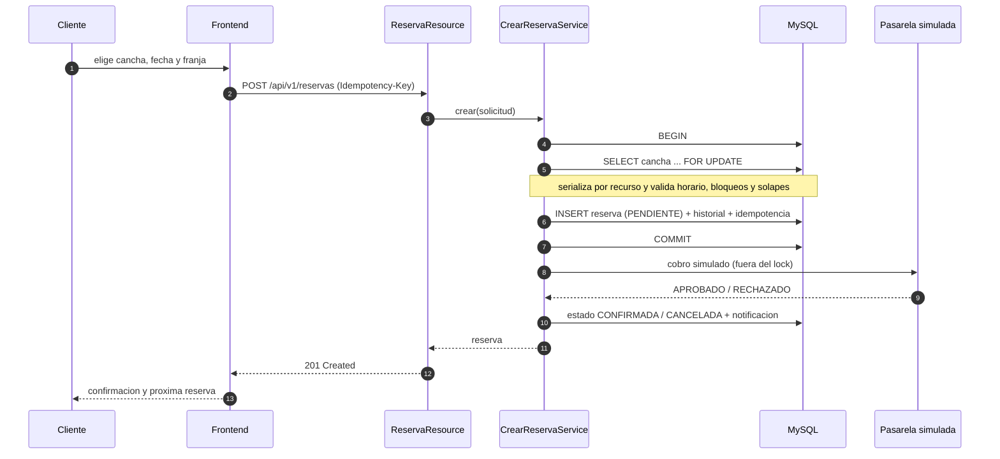
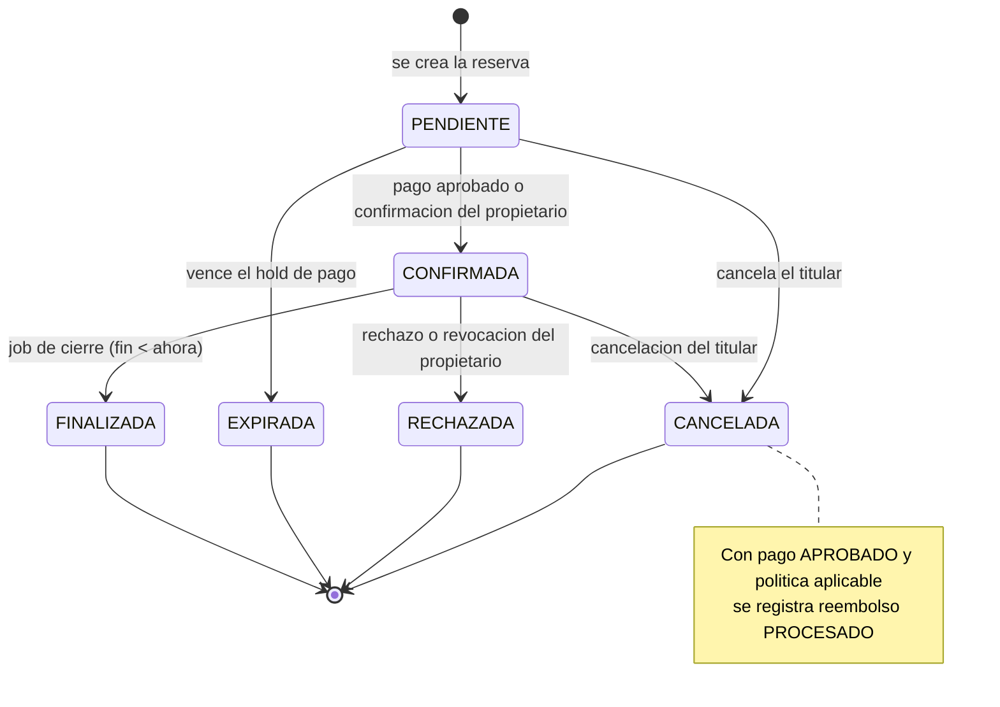
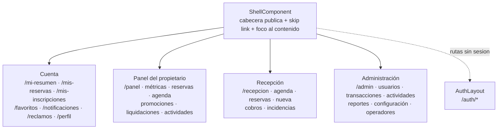
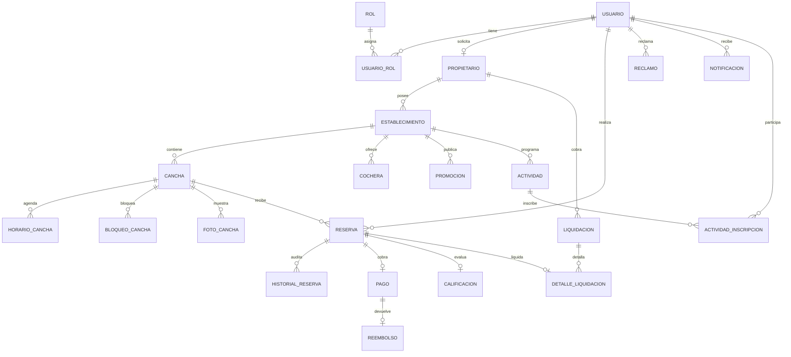

# Diagramas de arquitectura

Fuentes Mermaid de los diagramas del acta. Se renderizan en GitHub, GitLab, VS Code
(extension Markdown Preview Mermaid) y en <https://mermaid.live>. Las imagenes exportadas
para el documento final viven en `docs/evidencias/diagramas/`.

Convenciones: el sentido de las flechas es "depende de" o "llama a"; los puertos son los del
`compose.yml`; los nombres de tablas y modulos coinciden con el codigo.

## 1. Contexto (C4 nivel 1)

## 2. Contenedores y despliegue (Compose)

Modos soportados: backend nativo contra el MySQL del host, Compose contra el MySQL del host
(`host.docker.internal`) y Compose con MySQL aislado (`compose.mysql.yml`).

## 3. Modulos del backend (monolito modular + hexagonal)

Regla de dependencias: `domain` no conoce Quarkus, HTTP ni JPA; los puertos miran hacia dentro y
los adaptadores los implementan. `shared` concentra seguridad JWT, reloj, errores y utilidades.

## 4. Secuencia: reserva concurrente (ADR-0005)

Si el pago no llega dentro del hold, el job de expiracion pasa la reserva a `EXPIRADA` y libera
la franja (ADR-0022).

## 5. Estados de la reserva

## 6. Portales del frontend

Los guards son apoyo de UX: la autorizacion real vive en el backend (JWT + roles). Todas las
areas comparten estados de carga, vacio, error y exito, y el tema claro/oscuro se controla dentro
de cada portal.

## 7. Modelo de datos principal (ER simplificado)

El detalle de columnas, migraciones y restricciones esta en `MODELO_DATOS.md`; el esquema real lo
posee Flyway (V1..V18) e Hibernate solo valida.
